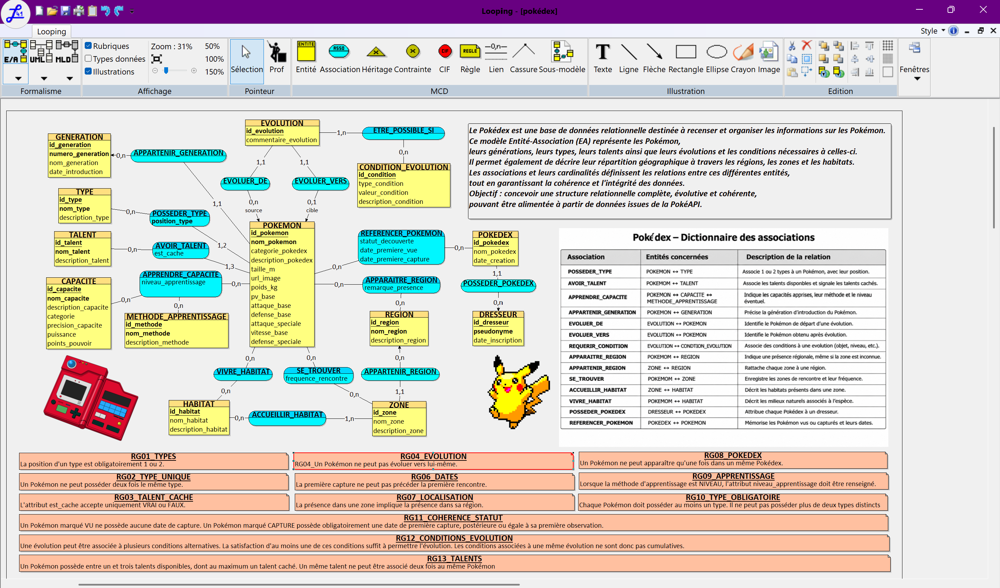
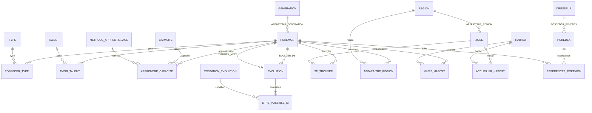

# Modélisation dans Looping

## Démarche

1. Délimitation du domaine et inventaire des concepts.
2. Identification des attributs, clés et associations.
3. Définition des cardinalités et des règles de gestion.
4. Génération du MLD et du SQL PostgreSQL.
5. Audit du SQL généré, correction dans Looping, nouvelle génération.
6. Validation sur la base locale et documentation des limites.

## Capture du MCD

La capture montre le modèle actuel de Looping. Dans le dictionnaire intégré à l'image, `REQUERIR_CONDITION` correspond au nom historique de `ETRE_POSSIBLE_SI`. La cardinalité minimale de `ACCUEILLIR_HABITAT` côté ZONE apparaît à 1 dans la capture, mais n'est pas imposée par le SQL actuel : les données correspondantes restent à documenter. Le fichier natif `.loo` reste à ajouter.

Le diagramme ci-dessous est une **synthèse textuelle des relations finales**, pas une capture de Looping. Les cardinalités reflètent les principaux choix d'après le modèle discuté et le SQL final ; les associations ternaires sont représentées comme une table associative pour la lisibilité.

Mermaid ne matérialise pas les maxima spécifiques 2 et 3 ; les règles ci-dessous les précisent. Le schéma SQL final est la référence pour les contraintes effectivement implantées.

## Dictionnaire des associations

| Association | Entités | Rôle |
| --- | --- | --- |
| POSSEDER_TYPE | POKEMON, TYPE | 1 ou 2 types distincts et leur position. |
| AVOIR_TALENT | POKEMON, TALENT | 1 à 3 talents, dont au plus un caché. |
| APPRENDRE_CAPACITE | POKEMON, CAPACITE, METHODE_APPRENTISSAGE | Association ternaire avec niveau éventuel. |
| APPARTENIR_GENERATION | POKEMON, GENERATION | Génération d'introduction. |
| EVOLUER_DE | EVOLUTION, POKEMON | Source d'une évolution. |
| EVOLUER_VERS | EVOLUTION, POKEMON | Cible ; au plus un prédécesseur direct. |
| ETRE_POSSIBLE_SI | EVOLUTION, CONDITION_EVOLUTION | Conditions alternatives ; au moins une. |
| APPARAITRE_REGION | POKEMON, REGION | Présence régionale, même si la zone précise est inconnue. |
| APPARTENIR_REGION | ZONE, REGION | Chaque zone appartient à une région. |
| SE_TROUVER | POKEMON, ZONE | Rencontres, fréquence éventuelle. |
| ACCUEILLIR_HABITAT | ZONE, HABITAT | Habitats associés à une zone. |
| VIVRE_HABITAT | POKEMON, HABITAT | Milieux associés aux espèces. |
| POSSEDER_POKEDEX | DRESSEUR, POKEDEX | Propriétaire du Pokédex. |
| REFERENCER_POKEMON | POKEDEX, POKEMON | Découverte et dates. |

## Règles de gestion

| Règle | Intention | Traduction dans PostgreSQL |
| --- | --- | --- |
| RG01 | Position d'un type : 1 ou 2 | CHECK |
| RG02 | Un même type ne peut être attribué deux fois | PK composée, UNIQUE sur la position |
| RG03 | Le talent caché est un booléen renseigné | BOOLEAN NOT NULL |
| RG04 | Pas d'évolution vers soi-même | CHECK sur source/cible |
| RG05 | Retirée car redondante avec RG09 | — |
| RG06 | La capture ne précède pas la première vue | CHECK sur dates |
| RG07 | Une rencontre dans une zone implique une présence régionale | 3 triggers de synchronisation/protection |
| RG08 | Une seule découverte par Pokémon et Pokédex | PK composée |
| RG09 | L'apprentissage NIVEAU exige un niveau positif | 2 triggers (association et renommage de méthode) |
| RG10 | Au moins un type et au maximum deux | 2 triggers différés + CHECK/UNIQUE |
| RG11 | VU sans date de capture ; CAPTURE avec date de capture | CHECK |
| RG12 | Au moins une condition par évolution ; alternatives OU | 2 triggers différés pour le minimum ; sémantique OU gérée par l'application/import |
| RG13 | Entre 1 et 3 talents, au maximum un caché | 2 triggers différés + index unique partiel |

La contrainte UNIQUE sur la cible d'une évolution reflète le choix d'un seul prédécesseur direct. Les critères cumulatifs fournis par l'API doivent être représentés dans une condition composée, pas dissociés en alternatives indépendantes. L'interdiction de l'auto-évolution ne garantit pas à elle seule l'absence de cycles plus longs.

La création d'un Pokémon et de ses types/talents, ou d'une évolution et de ses conditions, doit être réalisée dans une même transaction. Le respect des cardinalités minimales ne repose pas uniquement sur le dessin du MCD.
